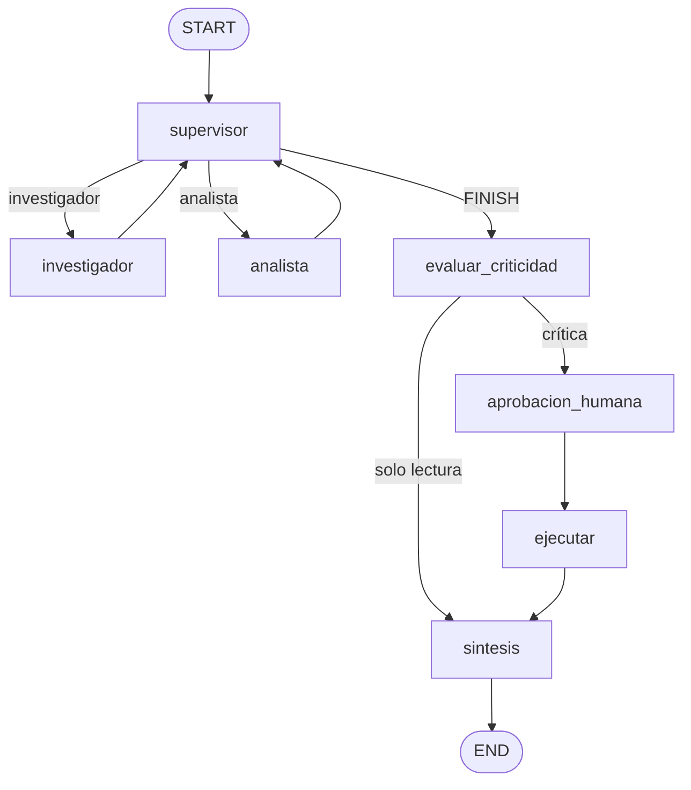

# Pre-entrega 7: API del orquestador

El multi-agente del módulo 6 (supervisor, investigador y analista) queda detrás
de una API que no espera a que el modelo termine. FastAPI anota el pedido en
Redis, devuelve un `job_id` y sigue atendiendo. Un worker del mismo proceso
saca el id de la cola, corre el grafo y actualiza el estado. El cliente
pregunta con `GET /tasks/{job_id}`.

Si el pedido pide una acción con efecto (registrar, notificar, ejecutar un
pago grande), el grafo se pausa y el estado pasa a `AWAITING_APPROVAL`. No
sigue hasta `POST /tasks/{job_id}/approve`. El checkpoint vive en Redis, así
que la pausa sobrevive a un reinicio de la API.

## Qué cubre

| Pieza | Dónde |
| --- | --- |
| `POST /tasks` encola y responde al instante | `app/main.py`, `app/worker.py` |
| Estado `PENDING` / `RUNNING` / `FAILED` / `DONE` en Redis | `app/worker.py` |
| Checkpoints del grafo en Redis (`RedisSaver`) | `app/main.py`, `app/graph.py` |
| Trazas a Arize Phoenix (o LangSmith) | `app/observability.py` |
| Pausa humana antes del aviso a RRHH | `app/hitl.py` |
| 5 POST concurrentes | `scripts/carga.py` |

Una consulta de solo lectura no se frena. La de demostración del módulo 6
(días de vacaciones) termina sola en `DONE`.

## Requisitos

- Python 3.12
- Docker, para Redis 8 y Phoenix
- La misma clave de OpenAI o Gemini que en el módulo 6
- `PINECONE_API_KEY` es opcional: si no responde, la búsqueda queda en BM25 sobre `data/`

## Cómo levantarlo

```bash
python3.12 -m venv .venv
source .venv/bin/activate
pip install torch --index-url https://download.pytorch.org/whl/cpu
pip install -r requirements.txt
cp .env.example .env
```

El primer `pip` instala PyTorch de CPU. El wheel por defecto de PyPI trae CUDA y pesa varios GB.

Completá `.env` con las claves del módulo 6. `REDIS_URL` y Phoenix pueden
quedar como están si usás el compose de abajo.

```bash
docker compose up -d
uvicorn app.main:app --host 0.0.0.0 --port 8000
```

Redis 8 trae RedisJSON y RediSearch, que el checkpointer necesita para
guardar el hilo. Phoenix queda en <http://localhost:6006> (proyecto
`techcorp-api`). La API documentada queda en <http://localhost:8000/docs>.

`GET /health` responde `{"status":"ok"}` cuando Redis contesta.

## Consulta de solo lectura

```bash
curl -s -X POST localhost:8000/tasks \
  -H "Content-Type: application/json" \
  -d '{"query":"Un empleado va a cumplir 12 años en TechCorp. La política acredita vacaciones por tramos de antigüedad: los primeros 5 años, los 5 siguientes y los años por encima de 10. ¿Cuántos días de vacaciones acumuló en total?"}'
```

La respuesta llega enseguida, con `status` en `PENDING`:

```json
{"job_id": "…", "status": "PENDING"}
```

```bash
curl -s localhost:8000/tasks/<job_id>
```

El estado pasa a `RUNNING` y, cuando el equipo termina, a `DONE`, con la
respuesta en `result`. Con un id inventado, la API responde 404.

## Cinco peticiones concurrentes

Con la API y Phoenix ya corriendo:

```bash
python scripts/carga.py
```

Hace 5 `POST /tasks` a la vez (la consulta de vacaciones, sin efecto) y
espera a que las cinco lleguen a un estado terminal. El tiempo que imprime
al principio es el de la API, no el de los modelos.

Después, en Phoenix (<http://localhost:6006>, proyecto `techcorp-api`):

1. La tabla de trazas de esa corrida. Cada fila es una ejecución. Ahí se ve
   la latencia y el costo que Phoenix calcula con los tokens de entrada y
   salida. Abrí una traza y dejá visibles los spans del supervisor, del
   investigador, del analista y de la síntesis.
2. El costo por ejecución (la columna de costo, o el detalle de la traza).
3. La latencia p95 del rango de tiempo que cubre esas cinco peticiones. Si
   el panel muestra P90 y P99 en vez de p95, capturá ese panel y nombrá el
   archivo con el percentil que se ve.

Guardá las capturas en `screenshots/`. Sin esas imágenes la observabilidad
no se puede evaluar: este repo no las genera.

Si la columna de costo sale vacía, el modelo no está en la tabla de precios
de Phoenix. En el proyecto se pueden cargar el precio de entrada y el de
salida del modelo (`gpt-4.1-mini` con OpenAI). Los tokens igual tienen que
verse en la traza.

## Tarea crítica (human-in-the-loop)

Es crítica si el texto pide un efecto: registrar un ajuste, notificar,
enviar un correo, ejecutar un reembolso, o pagar un monto de 1000 USD o más.
El umbral y las frases están en `app/hitl.py`.

```bash
curl -s -X POST localhost:8000/tasks \
  -H "Content-Type: application/json" \
  -d '{"query":"Calculá los días de vacaciones de un empleado con 12 años en TechCorp y, cuando tengas el total, registrá el ajuste en su legajo y notificá a RRHH."}'
```

Cuando el equipo ya investigó y calculó, `GET /tasks/{job_id}` queda en
`AWAITING_APPROVAL`. `interrupt` trae la pregunta para el revisor. Recién
ahí se decide:

```bash
curl -s -X POST localhost:8000/tasks/<job_id>/approve \
  -H "Content-Type: application/json" \
  -d '{"aprobado": true}'
```

Ese POST también vuelve enseguida (`PENDING`). El worker reanuda el mismo
`thread_id`. Si `aprobado` es `true`, deja el aviso en `avisos/rrhh.jsonl` y
el job termina en `DONE`. Si es `false`, no se escribe el aviso y la
respuesta dice que el revisor rechazó.

Aprobar un job que no está esperando responde 409. Aprobar dos veces el
mismo id también: el efecto corre una sola vez.

Para ver que el checkpoint está en Redis y no en memoria: llegá un job a
`AWAITING_APPROVAL`, cortá uvicorn, volvé a levantarlo y aprobá. Tiene que
seguir el mismo hilo.

## Topología



El aviso a RRHH está en `ejecutar`, después del `interrupt`. Al reanudar,
`aprobacion_humana` vuelve a empezar: por eso no escribe nada antes de la pausa.

## Si algo falla

- La API no arranca y el error habla de índices: Redis no tiene RediSearch.
  Usá `docker compose up -d` de este directorio, no un Redis viejo sin módulos.
- Un job queda en `FAILED`: `error` tiene el motivo. Un reinicio a mitad de
  una corrida también lo marca `FAILED` para que el poll no siga para siempre.
  Un job en `AWAITING_APPROVAL` no se toca al reiniciar.
- No aparecen trazas: Phoenix tiene que estar arriba antes de la consulta, y
  `PHOENIX_COLLECTOR_ENDPOINT` tiene que ser `http://localhost:6006`. Las
  trazas salen en el proyecto `techcorp-api`.
- Para usar LangSmith en vez de Phoenix: `OBSERVABILIDAD=langsmith` y
  `LANGSMITH_API_KEY` en `.env`. `both` manda a los dos.

## Prueba sin LLM

La pausa y la regla de criticidad no necesitan claves:

```bash
python tests/test_flujo.py
```
